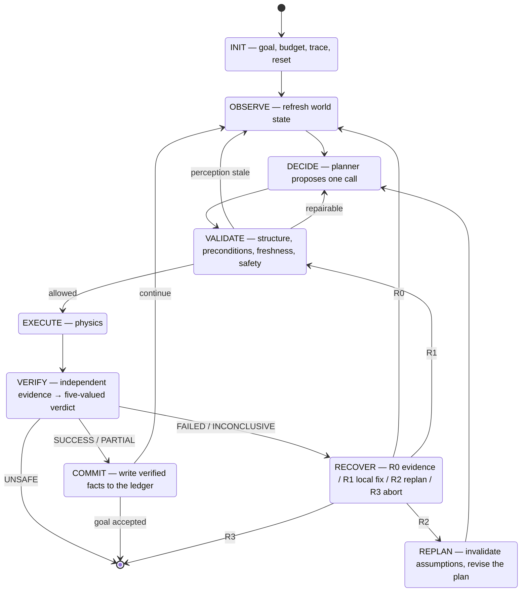
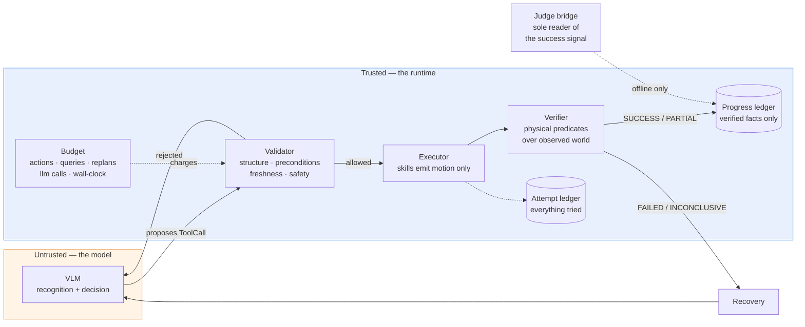

<div align="center">

# vlm-sim-harness

**A trust boundary between a vision-language model and a simulated robot.**

[](https://github.com/cyh710/vlm-sim-harness/actions/workflows/ci.yml)
[](https://www.python.org/)
[](LICENSE)
[](tests/)
[-blue)](requirements.txt)

[Overview](#overview) · [Method](#method) · [Results](#results) · [Quickstart](#quickstart) ·
[Evaluation Design](#evaluation-design) · [Status](#status--scope) · [Design Notes](#design-notes) · [Citation](#citation)

[中文版 (Chinese)](README_zh.md)

</div>

---

## Overview

Most "VLM robot" demos show a model that acts and then reports success. The model
**believes** it succeeded; nobody checks. The video looks right. The success
rate in the paper is right. And somewhere underneath, the agent claimed a
grasp it never got, released an object into thin air, and ended the episode
green.

This project is the layer that makes that belief checkable — and it measures
whether the layer actually helps, in simulation, with a pre-registered
experiment.

```
   VLM proposes  ──▶  Validator gates  ──▶  Executor acts  ──▶  Verifier judges  ──▶  Ledger records
     (untrusted)        (preconditions)        (physics)         (evidence)            (facts only)
```

A planner may only **propose**. Every physical effect must be **independently
verified** before it is allowed to become a fact.

Two design consequences follow, and they are what this repository is about:

**1. Success is judged from evidence, not from the model's claim.**
The verifier evaluates *physical predicates* over the observed world
(`holding`, `contained`, `displacement_min`, …). Its verdict is the only thing
that reaches the progress ledger. A model cannot assert its own success.

**2. "I don't know" is a first-class outcome.**
The verdict is five-valued — `SUCCESS / PARTIAL / FAILED / INCONCLUSIVE /
UNSAFE`. `INCONCLUSIVE` means *evidence insufficient*, and it is distinct from
`FAILED` because **a timeout is not a failure**: the robot may already have
moved the object. Re-sending an unknown-outcome physical action is forbidden,
since physical actions are not idempotent.

**Simulation is the point, not a limitation.** A simulator is what makes the
question answerable: you can inject a fault at a known instant, replay the
same seed across arms, and read ground truth the agent never saw. That is how
the result below was obtained — 431 episodes on
[RLBench](https://github.com/stepjam/RLBench), paired by seed, with the
primary endpoint frozen in advance.

### Who this is for

| | |
|---|---|
| ✅ **Good fit** | You're building a VLM/LLM agent that acts on a robot, a browser, or a computer. You need to know whether its "done" is real — and you need that answer to be *measurable*, not asserted. |
| ✅ **Good fit** | You're doing agent evaluation and need a reference implementation of evidence-driven verification, pre-registration, and paired statistics. |
| ✅ **Good fit** | You're designing the safety boundary between a model and anything with irreversible consequences. The trust-boundary pattern transfers directly. |
| ❌ **Not a fit** | You want a pretrained policy or a VLA checkpoint. This repo ships **no model weights** — it is the execution and evaluation layer *around* a model. |
| ❌ **Not a fit** | You want to run on a real robot. The published backend is a simulator; the hardware backends are not included (see [Status](#status--scope)). |
| ❌ **Not a fit** | You're training a policy. Nothing here is about gradient updates. |

---

## Method

### The nine-state loop



### The trust boundary



Three mechanisms enforce the boundary, and they are the reason the harness
exists:

| Mechanism | Where | What it prevents |
|---|---|---|
| Planner-claimed effects discarded | verifier evaluates the Registry's trusted effect template, never the model's `expected_effects` | The model asserting its own success |
| Freshness stamped by the runtime | `world_version` compared against what the runtime actually observed | The model replaying a stale pose |
| Only S6 writes the ledger | `ProgressLedger` is reachable only from S6 | Unverified effects becoming facts |

`scripts/check_oracle_isolation.py` enforces this **statically** — it fails the
build if `success()`, `reward`, or an oracle read appears anywhere outside the
judge bridge. A convention that is only written down is one that decays.

### The VLM protocol: the model names, the code localizes

Letting a VLM emit pixel coordinates is tempting and wrong. Measured on this
task, free-form coordinates from the model had a **median error of 237 mm**,
with 15 of 17 samples off by more than 100 mm — worse than no answer, because
it looks plausible.

So the model is never asked for a coordinate. It is asked a question it is
actually good at:

> *Here is the scene, and here is an instance-partitioned copy of it with
> numbered instances. Which number is the paper ball?*

```
  image 1: raw scene          image 2: same frame, instances filled with
  (true appearance)           saturated color + numbered markers
                              ↓
                    VLM answers {"1": "rubbish", "2": "bin"}
                              ↓
                    code looks up instance #1's registered pose
```

The split is the point: **the model contributes semantics, the perception
stack contributes geometry.** The goal DSL, validator and verifier are
identical either way — recognition only re-publishes instances under canonical
ids.

---

## Results

431 episodes on the RLBench simulator, paired seeds, paired bootstrap
(10 000 resamples, fixed RNG).

**Primary endpoint — C vs A under receipt loss (F2): `+0.881`, 95% CI
`[0.786, 0.976]`** (42 paired seeds, 37 discordant).

| Arm | Harness configuration | N0 (no fault) | F2 (receipt lost) | repeated re-grasp | false completion |
|---|---|---|---|---|---|
| **A** | self-report only | 0.70 | **0.08** | 0.09 | 0 |
| **B** | + independent verification | 0.73 | 0.83 | 0.19 | 0 |
| **C1** | + recovery | — | 0.96 | 0.05 | 0 |
| **C** | + replan + progress ledger | — | **0.93** | 0.07 | 0 |

*Arms differ only on four runtime switches — same model, same prompt, same
seeds, same perception, same budget caps, same accounting implementation.*

Under receipt loss, a self-report-driven agent scores **0.08** because it
cannot tell "the grasp failed" from "the receipt was lost", so it either
re-grasps or gives up. The same agent inside the harness scores **0.93**,
because the harness re-verifies the *same* call id against fresh evidence.

Two findings worth more than the headline number:

- **B < A under N0 (0.73 vs 0.70).** Honest feedback *without* a recovery
  mechanism creates jitter: the agent receives an accurate "I don't know if
  that worked" verdict and can only act on its own reading of the evidence, so
  it re-tries more. This is a real negative result, and it is the argument for
  having recovery at all.
- **Cost per success goes the wrong way.** Arm C uses *fewer* physical actions
  and LLM calls per success than arm A (2.0 / 3.0 vs 2.79 / 3.89). The harness
  is not buying reliability with compute.

Reproduce the analysis from the shipped episode rows — the output is
byte-identical to the published analysis file:

```bash
python scripts/analyze_m5.py results/m5/m5_confirm_merged_rows.json
```

---

## Quickstart

The framework layer has **zero third-party dependencies** — `numpy` and
`pillow` are imported lazily, only when an image is actually encoded for the
model. All 108 tests pass with both blocked. No API key, no simulator, no
robot.

```bash
git clone https://github.com/cyh710/vlm-sim-harness.git
cd vlm-sim-harness

python -m pytest tests/ -q          # 108 tests
python scripts/run_mock.py           # 10-scenario mock matrix
```

Expected output:

```
108 passed in 0.44s
...
ALL GREEN
```

That's the whole setup. The VLM path is exercised offline too —
`tests/fake_vlm.py` replaces *only* what the model says, while the runtime,
validator, verifier, ledgers and budget stay real. `tests/test_vlm_end_to_end.py`
drives a full `grasp → place → done` episode through all nine states with no
network access.

### Running against a real model

```bash
pip install -r requirements.txt
cp .env.example .env                  # fill in your key; .env is gitignored
```

```bash
export VLM_BASE_URL="https://api.anthropic.com"
export VLM_API_KEY="sk-..."          # never commit this
export VLM_MODEL="claude-sonnet-5"
```

`harness/planning/vlm_planner.py` speaks the Anthropic Messages protocol
(multimodal content blocks). `ANTHROPIC_*` and `DEEPSEEK_*` are accepted as
aliases, and the endpoint is injected at construction time, so any gateway that
accepts the `/v1/messages` shape works.

### Running against the simulator

The experiment backend is [RLBench](https://github.com/stepjam/RLBench) (Imperial
College London), reached through `harness/adapters/rlbench_adapter.py`. RLBench
carries its own non-commercial research licence and is **not** redistributed
here — install it per its own instructions (it needs CoppeliaSim and PyRep).

```bash
pip install -r requirements-sim.txt
pip install rlbench pyrep             # per RLBench's own instructions
```

The adapter imports `rlbench`/`pyrep` lazily, so the framework stays importable
without them — `import harness.adapters.rlbench_adapter` works on a machine
that has never seen a simulator, and the contract tests
(`tests/test_rlbench_adapter.py`) check the wiring without starting one.

### Bringing your own backend

The framework never imports a backend. Implement `Adapter`
(`observe / execute / shutdown`) plus a judge bridge, and the runtime, decision
layer, verification layer and evaluation are unchanged.
`harness/adapters/mock_adapter.py` is a complete reference implementation.

---

## Evaluation Design

The harness exists to be *measured*, so the measurement apparatus is part of the
codebase rather than an afterthought.

**Four arms, one variable.** The arms differ **only** on four runtime switches
(`s5_verifier`, `recovery`, `replan_enabled`, `progress_ledger`). Same model,
same prompt, same seeds, same perception, same budget caps, same accounting
implementation. The switches are locked by `tests/test_m5_arms.py`.

**Pre-registration with hash freezing.** `configs/preregistration.json` freezes
the skill manifest, the DSL whitelist, both prompt hashes, and the calibration
table. `check_manifest_stable.py` fails if any of them drift. A prompt edited
mid-experiment invalidates the run — and now that is mechanically detectable
rather than a matter of discipline.

**Accounting that cannot be gamed.** Every planner call — decision, replan, or
recovery — charges exactly one `llm_calls` slot in every arm, through one
implementation. So "which arm is cheaper" reflects architecture rather than
bookkeeping differences. Physical actions, queries, replans, wall-clock and
no-progress cycles are metered separately.

**The fault model.** The interesting failure is not "the robot dropped the
object" — that is physics. It is **F2: receipt loss**, where a grasp
physically succeeded but the call returns a timeout. A naive agent re-grasps
(double grip, second collision) or gives up. A harness-driven agent re-verifies
the *same* call id against fresh evidence and continues.

### Repository layout

```
harness/
  spec/        runtime FSM · DSL verifier · validator · ledgers · budget · safety
  planning/    VLM planner (recognition + decision) · LLM planner · SoM recognizer
  skills/      grasp / place / motion — motion only, never verdicts
  adapters/    judge bridge (oracle boundary) · RLBench backend · mock backend
configs/       frozen thresholds · task asset descriptions · preregistration
results/       calibration tables (the single source of truth for verdicts)
               m5/ — 431 episode rows + the analysis derived from them
scripts/       mock matrix · oracle isolation check · manifest drift check · analysis
tests/         108 tests, offline, no API key and no simulator required
docs/DESIGN.md decisions, and the ones that turned out to be wrong
```

---

## Status & Scope

**What ships here.** The framework layer, the VLM application layer, and the
RLBench simulator backend that the 431-episode experiment ran on. The framework
is platform-independent — a backend arrives through the `Adapter` interface.

| | Status |
|---|---|
| Nine-state loop, trust boundary, ledger semantics, budget accounting, pre-registration guard | ✅ tested |
| VLM protocol — dual-image SoM, recognition-map uniqueness, id translation, place normalization, prompt freezing, transport retry, protocol-error handling | ✅ tested |
| RLBench backend — adapter contract, fault-injection switches, judge bridge | ✅ contract-tested (needs RLBench installed to actually run) |
| Four-arm experiment — 431 episodes, primary endpoint with 95% CI | ✅ reproducible from shipped rows |
| VLM-in-the-loop task success under real perception | ⚠️ **not yet measured** — see below |

**What is deliberately absent**, and why:

- **A real-perception backend.** The published adapter runs in `gt_debug`
  mode: object poses come from the simulator scene. That is what the
  experiment used. A `sensor_eval` mode — objects sourced only from the vision
  chain — needs a perception stack (segmentation + instance registration) that
  is not part of this repository. The adapter **raises** for that mode rather
  than silently falling back to ground truth, because a silent fallback would
  turn "a conclusion about real perception" into "a conclusion about ground
  truth" while the logs looked normal.
- **Other physical backends** (CoppeliaSim / UR5 / ROS 2) — they need licensed
  simulator assets and a robot. They plug in through `Adapter`.
- **Model weights** — this is the execution and evaluation layer *around* a
  model, not a model.
- **A direct-VLM baseline arm** — the obvious comparison (same model, raw tool
  calls, same budget and seeds) exists only as the anecdote that motivated the
  SoM protocol. It has never been run as an arm, so the protocol's value is
  currently *argued* rather than measured.

**The honest gap.** An earlier run of the VLM-in-the-loop configuration produced
zero successes. The cause was a defect in the `place` branch of the VLM planner:
the container pose was being overwritten by the held object's pose, so the drop
target was the object's own location. That defect is fixed and covered by
`tests/test_vlm_planner.py`; the end-to-end offline episode now completes.
**Re-measuring the success rate with the perception chain is the next step, and
this repository does not publish a number it has not measured.**

Full list of open problems — including the recognition ablation at n = 8, the
unpublished cost/latency curve, and the missing baseline arm — is in
[docs/DESIGN.md § 9](docs/DESIGN.md).

---

## Design Notes

[`docs/DESIGN.md`](docs/DESIGN.md) records the decisions and — more usefully —
the ones that turned out to be **wrong**: how each was found, and what the
misdiagnosis cost.

One example, because it is representative: a defect in the `place` branch made
the drop target the held object's own location. It was visible in the logs for
weeks and was blamed on the model misidentifying the container. It was actually
a branch nobody had ever run. It survived 328 real episodes, a 32-failure-run
environment investigation, and a 38 KB engineering log — and did not survive one
deterministic offline test that anyone can run in a second.

---

## Citation

This project is not published as a paper. If you use the framework, the
evaluation design, or the fault model in your own work, please cite the
underlying benchmarks and prior art properly:

```bibtex
@misc{vlm_agent_harness_2026,
  title       = {vlm-sim-harness: a trust-boundary execution and
                 evaluation harness for VLM-driven embodied agents},
  author      = {cyh710},
  year        = {2026},
  howpublished = {\url{https://github.com/cyh710/vlm-sim-harness}},
  license     = {MIT}
}
```

The four-arm experiment was run on **RLBench** (Imperial College London), which
carries its own non-commercial research licence; it is not redistributed here
and is reached through the `Adapter` interface only.

Related work this design draws on:

- **SayCan** — affordance-grounded skill selection
- **ProgPrompt** — programmatic state-machine prompting for embodied agents
- **Inner Monologue** — closed-loop feedback in language models
- **ReAct** — reasoning traces as the agent's action interface
- **Set-of-Mark prompting** — instance-level visual prompting
- **RLBench** — the robot manipulation benchmark used for the experiment

---

## License

MIT — see [LICENSE](LICENSE).
