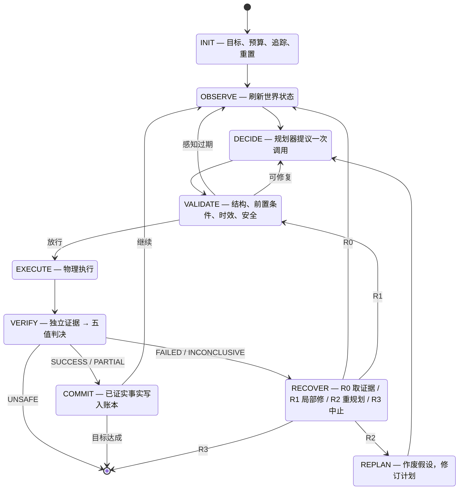
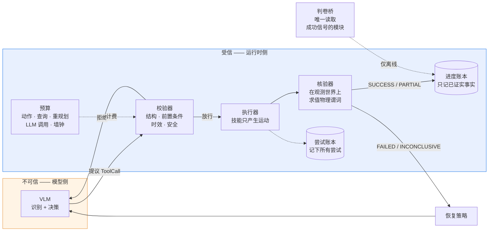

<div align="center">

# vlm-sim-harness

**给 VLM 与仿真机器人之间加一道信任边界。**

[](https://github.com/cyh710/vlm-sim-harness/actions/workflows/ci.yml)
[](https://www.python.org/)
[](LICENSE)
[](tests/)
[-blue)](requirements.txt)

[概览](#概览) · [方法](#方法) · [结果](#结果) · [快速开始](#快速开始) ·
[评测设计](#评测设计) · [现状与范围](#现状与范围) · [设计笔记](#设计笔记) · [引用](#引用)

[English](README.md)

</div>

---

## 概览

大多数「VLM 机器人」演示展示的是：模型动作一下，然后报告成功。模型**相信**
自己成功了，但没人去核对。视频看着没问题，论文里的成功率也没问题 —— 而在
底下某一层，agent 声称抓住了一个它根本没抓住的东西，把物体释放到了空气里，
然后整集以绿色结束。

这个项目做的，就是让那份「相信」变得**可被检验** —— 并且用一次预注册的实验
去测量这层边界到底有没有用。

```
   VLM 提议  ──▶  校验器放行  ──▶  执行器动作  ──▶  核验器判定  ──▶  账本记录
     （不可信）      （前置条件）      （物理）        （证据）          （只记事实）
```

规划器只能**提议**。每一个物理效果，都必须先被**独立核验**，才允许成为事实。

由此推出两条设计结论，也正是这个仓库的主题：

**1. 成功由证据判定，不由模型的声明判定。**
核验器在观测到的世界上求值**物理谓词**（`holding`、`contained`、
`displacement_min` 等）。它的判决是唯一能写进进度账本的东西。模型无法断言
自己的成功。

**2.「我不知道」是一个一等结果。**
判决是五值的 —— `SUCCESS / PARTIAL / FAILED / INCONCLUSIVE / UNSAFE`。
`INCONCLUSIVE` 意味着**证据不足**，它与 `FAILED` 严格区分，因为
**超时不是失败**：机器人可能已经把物体移动了。对结果未知的物理动作禁止
重发 —— 物理动作不是幂等的。

**仿真不是妥协，是这个问题的前提。** 正因为有仿真器，才能在已知的时刻注入
故障、跨臂重放同一个 seed、读到 agent 从没见过的真值 —— 下面的结果就是这么
来的：RLBench 上 431 集，按 seed 配对，主端点在跑之前就冻结了。

### 适合谁 / 不适合谁

| | |
|---|---|
| ✅ **适合** | 你在做一个会操作机器人、浏览器或电脑的 VLM/LLM agent。你需要知道它的「完成」是不是真的，而且需要这个答案**可测量**，而不是靠声明。 |
| ✅ **适合** | 你在做 agent 评测，需要一个「证据驱动核验 + 预注册 + 配对统计」的参考实现。 |
| ✅ **适合** | 你在设计模型与任何**不可逆后果**之间的安全边界。这套信任边界模式可以直接迁移。 |
| ❌ **不适合** | 你想要预训练策略或 VLA checkpoint。本仓库**不含模型权重** —— 它是包在模型外面的执行与评测层。 |
| ❌ **不适合** | 你想在真机上跑。发布的后端是仿真器；硬件后端被有意排除在外（见[现状与范围](#现状与范围)）。 |
| ❌ **不适合** | 你要训练策略。这里没有任何梯度更新相关的东西。 |

---

## 方法

### 九状态主循环



### 信任边界



三道机制共同守住这条边界，也正是这个框架存在的理由：

| 机制 | 位置 | 防住什么 |
|---|---|---|
| 丢弃规划器声称的效果 | 核验器求值的是技能表里的受信效果模板，不是模型的 `expected_effects` | 模型断言自己的成功 |
| 时效由运行时盖章 | `world_version` 与运行时**实际观测**到的版本比对 | 模型重放过期位姿 |
| 只有 S6 能写账本 | `ProgressLedger` 只有 S6 能触达 | 未证实的效果变成「事实」 |

`scripts/check_oracle_isolation.py` 用**静态检查**强制这条边界 —— 只要
`success()`、`reward` 或 oracle 读取出现在判卷桥之外，构建就失败。
只写在文档里的约定是会衰减的。

### VLM 协议：模型命名，代码定位

让 VLM 直接输出像素坐标很诱人，而且错。实测在本任务上，模型自由输出的坐标
**中位误差 237 mm**，17 个样本里有 15 个偏差超过 100 mm —— 这比没有答案更糟，
因为它看起来很合理。

所以从不让模型给坐标。只问它一个它真正擅长的问题：

> *这是场景原图，这是同一帧的实例分割版本，每个实例都有编号。哪个编号是纸团？*

```
  图 1: 场景原图            图 2: 同一帧，实例填饱和纯色 + 编号
  （真实外观）                  ↓
                    VLM 回答 {"1": "rubbish", "2": "bin"}
                              ↓
                    代码按编号查注册表位姿
```

分界线就在这里：**模型贡献语义，感知栈贡献几何**。目标 DSL、校验器、核验器
两边完全一致 —— 识别只是把实例以规范 id 重新发布。

---

## 结果

RLBench 仿真器上 431 集，配对种子，配对 bootstrap（10000 次重采样，固定 RNG）。

**主端点 —— 回执丢失（F2）下 C vs A：`+0.881`，95% CI `[0.786, 0.976]`**
（42 个配对 seed，37 对不一致）。

| 臂 | 框架配置 | N0（无故障） | F2（回执丢失） | 重复重抓率 | 假完成率 |
|---|---|---|---|---|---|
| **A** | 只信自报 | 0.70 | **0.08** | 0.09 | 0 |
| **B** | + 独立核验 | 0.73 | 0.83 | 0.19 | 0 |
| **C1** | + 恢复机制 | — | 0.96 | 0.05 | 0 |
| **C** | + 重规划 + 进度账本 | — | **0.93** | 0.07 | 0 |

*四臂只差四个运行时开关 —— 同模型、同提示词、同种子、同感知、同预算上限、
同一套计费实现。*

回执丢失时，只信自报的 agent 得分 **0.08**，因为它分不清「抓取失败」和
「回执丢了」，于是要么重抓、要么放弃。同一个 agent 放进这个框架得分
**0.93** —— 因为框架会拿新的证据去**重验同一个 call id**。

两个比主数字更值得说的发现：

- **N0 下 B < A（0.73 vs 0.70）。** 没有恢复机制的**诚实反馈反而制造抖动**：
  agent 拿到一个准确的「我不知道成没成」判决，只能凭自己对证据的解读行动，
  于是重试更多。这是个真实的阴性结果，也是「为什么必须有恢复机制」的论据。
- **每次成功的成本是反的。** C 臂每次成功用的物理动作和 LLM 调用都**更少**
  （2.0 / 3.0 vs 2.79 / 3.89）。这个框架不是用算力换可靠性。

从随仓发布的逐集数据复现分析，输出与已发布的分析文件**逐字节一致**：

```bash
python scripts/analyze_m5.py results/m5/m5_confirm_merged_rows.json
```

---

## 快速开始

框架层**零第三方依赖** —— `numpy` 和 `pillow` 是惰性导入，只有真的要编码
图像发给模型时才需要。屏蔽这两个包后 108 个测试仍全部通过。不需要 API key、
不需要仿真器、不需要机器人。

```bash
git clone https://github.com/cyh710/vlm-sim-harness.git
cd vlm-sim-harness

python -m pytest tests/ -q          # 108 个测试
python scripts/run_mock.py           # 10 场景 mock 矩阵
```

预期输出：

```
108 passed in 0.44s
...
ALL GREEN
```

就这些。VLM 通路也能离线跑 —— `tests/fake_vlm.py` 只替换**模型说了什么**，
运行时、校验器、核验器、账本、预算全是真的。`tests/test_vlm_end_to_end.py`
用假模型驱动一整集 `grasp → place → done` 走完九个状态，全程不联网。

### 对接真实模型

```bash
pip install -r requirements.txt
cp .env.example .env                  # 填你的 key；.env 已被 gitignore
```

```bash
export VLM_BASE_URL="https://api.anthropic.com"
export VLM_API_KEY="sk-..."          # 永远不要提交这个
export VLM_MODEL="claude-sonnet-5"
```

`harness/planning/vlm_planner.py` 走 Anthropic Messages 协议（多模态 content
块）。也接受 `ANTHROPIC_*` / `DEEPSEEK_*` 作为别名；端点在构造时注入，
所以任何接受 `/v1/messages` 形状的网关都能用。

### 对接仿真器

实验后端是 [RLBench](https://github.com/stepjam/RLBench)（Imperial College
London），通过 `harness/adapters/rlbench_adapter.py` 接入。RLBench 自带非商业
研究许可，**不在本仓再分发** —— 请按它自己的说明安装（需要 CoppeliaSim 和
PyRep）。

```bash
pip install -r requirements-sim.txt
pip install rlbench pyrep             # 按 RLBench 自己的说明
```

适配器对 `rlbench`/`pyrep` 是惰性导入的，所以框架在没有它们的机器上依然能
import —— `import harness.adapters.rlbench_adapter` 在从没见过仿真器的机器上
也能跑通，契约测试（`tests/test_rlbench_adapter.py`）不启动仿真器就能检查
接线是否正确。

### 接入你自己的后端

框架从不 import 后端。实现 `Adapter`（`observe / execute / shutdown`）加上
一个判卷桥，运行时、决策层、核验层、评测层全部不变。
`harness/adapters/mock_adapter.py` 是完整的参考实现。

---

## 评测设计

框架的存在意义就是**被测量**，所以测量装置是代码库的一部分，不是事后补的。

**四臂，一个变量。** 四臂**只**差四个运行时开关（`s5_verifier`、
`recovery`、`replan_enabled`、`progress_ledger`）。同模型、同提示词、同种子、
同感知、同预算上限、同一套计费实现。这些开关由 `tests/test_m5_arms.py`
锁住。

**预注册 + 哈希冻结。** `configs/preregistration.json` 冻结技能表、DSL 词表、
两个提示词的哈希、以及标定表。`check_manifest_stable.py` 在任何一项漂移时
失败。实验中途改提示词会让结果失效 —— 而现在这件事是**机器可检出的**，
不再靠自觉。

**无法被做假的记账。** 每次规划器调用 —— 决策、重规划还是恢复 —— 在任何一臂
里都通过同一份实现记一笔 `llm_calls`。所以「哪一臂更省」反映的是架构差异，
而不是记账差异。物理动作、查询、重规划、墙钟、无进展循环分别单独计量。

**故障模型。** 有意思的失败不是「机器人把东西掉了」—— 那是物理。真正有意思的是
**F2：回执丢失** —— 抓取物理上成功了，但调用返回超时。naive agent 会重抓
（双重夹持、二次碰撞）或者放弃。有框架的 agent 会拿新证据去**重验同一个
call id** 然后继续。

### 仓库结构

```
harness/
  spec/        运行时 FSM · DSL 核验器 · 校验器 · 双账本 · 预算 · 安全
  planning/    VLM 规划器（识别+决策）· LLM 规划器 · SoM 识别器
  skills/      grasp / place / motion —— 只产生运动，不产生判决
  adapters/    判卷桥（oracle 边界）· RLBench 仿真后端 · mock 后端（框架自检）
configs/       冻结阈值 · 任务资产描述 · 预注册
results/       标定表（判决的唯一真源）
               m5/ —— 431 集逐集数据 + 由它算出的分析
scripts/       mock 矩阵 · oracle 隔离检查 · 清单漂移检查 · 分析
tests/         108 个测试，离线，不需要 API key 也不需要仿真器
docs/DESIGN.md 决策记录，以及那些被证明是错的决策
```

---

## 现状与范围

**这里发布的是**：框架层 + VLM 应用层 + 431 集实验所跑的 RLBench 仿真后端。
框架与平台无关 —— 后端通过 `Adapter` 接口接入。

| | 状态 |
|---|---|
| 九状态循环、信任边界、账本语义、预算记账、预注册守卫 | ✅ 有测试 |
| VLM 协议 —— 双图 SoM、识别映射唯一性、id 翻译、place 规范化、提示词冻结、传输重试、协议错误处理 | ✅ 有测试 |
| RLBench 后端 —— 适配器契约、故障注入开关、判卷桥 | ✅ 有契约测试（真跑需要装 RLBench） |
| 四臂实验 —— 431 集，主端点带 95% CI | ✅ 可从随仓数据复现 |
| VLM 在环的真实感知任务成功率 | ⚠️ **尚未测量** —— 见下 |

**有意不包含的东西**，以及原因：

- **真实感知后端。** 发布的适配器跑的是 `gt_debug` 模式：物体位姿直接来自
  仿真场景 —— 实验就是这么跑的。`sensor_eval` 模式（物体只来自视觉链路）
  需要一套感知栈（分割 + 实例注册），不在本仓内。适配器对该模式**直接报错**
  而不是悄悄退回真值 —— 悄悄退回会把「关于真实感知的结论」变成「关于真值的
  结论」，而日志看起来完全正常。
- **其他物理后端**（CoppeliaSim / UR5 / ROS 2）—— 它们需要授权的仿真器资产和一台
  机器人。它们通过 `Adapter` 接入。
- **模型权重** —— 这是包在模型外面的执行与评测层，不是模型。
- **「直接 VLM 控制」对照臂** —— 最自然的对照（同一模型、直接输出工具调用、
  同预算同种子）目前只作为促使 SoM 协议立项的那个轶事存在，从未作为一臂
  正式跑过。所以这个协议的价值目前是**被论证**的，不是**被测量**的。

**诚实的缺口。** 早先一版 VLM 在环的配置跑出零成功。根因是 VLM 规划器
`place` 分支里的一个缺陷：容器位姿被手中物的位姿覆盖，导致投放点落在物体
自己的位置上。这个缺陷已修，并由 `tests/test_vlm_planner.py` 覆盖；离线的
端到端整集现在能跑完。**接上感知链后重测成功率是下一步，而本仓库不发布
未经测量的数字。**

完整的未解决问题清单 —— 包括 n = 8 的识别消融、未发布的成本/延迟曲线、
缺失的对照臂 —— 见 [docs/DESIGN.md § 9](docs/DESIGN.md)。

---

## 设计笔记

[`docs/DESIGN.md`](docs/DESIGN.md) 记录决策，以及更有价值的 —— **那些被证明
是错的**决策：每一个是怎么被发现的，以及误判的代价。

举一个代表性的例子：`place` 分支的缺陷让投放点落在被放物体自己的位置上。
它在日志里显形了好几周，一直被归因为「模型把容器认错了」。实际是**一个从来
没人跑过的分支**。它躲过了 328 集真实 episode、一次 32 集失败的环境排查、
一份 38 KB 的工程日志 —— 却没躲过一个任何人都能在一秒内跑完的确定性离线
测试。

---

## 引用

本项目未作为论文发表。如果你在自己的工作中用到了这个框架、评测设计或故障
模型，请正确引用底层 benchmark 与前人工作：

```bibtex
@misc{vlm_agent_harness_2026,
  title       = {vlm-sim-harness: a trust-boundary execution and
                 evaluation harness for VLM-driven embodied agents},
  author      = {cyh710},
  year        = {2026},
  howpublished = {\url{https://github.com/cyh710/vlm-sim-harness}},
  license     = {MIT}
}
```

四臂实验跑在 **RLBench**（Imperial College London）上，它有独立的非商业研究
许可；此处不分发它，只通过 `Adapter` 接口对接。

本设计借鉴的工作：

- **SayCan** —— 基于可供性的技能选择
- **ProgPrompt** —— 具身 agent 的程序化状态机提示
- **Inner Monologue** —— 语言模型中的闭环反馈
- **ReAct** —— 以推理轨迹作为 agent 的动作接口
- **Set-of-Mark 提示** —— 实例级视觉提示
- **RLBench** —— 用于实验的机器人操作 benchmark

---

## 许可

MIT —— 见 [LICENSE](LICENSE)。
